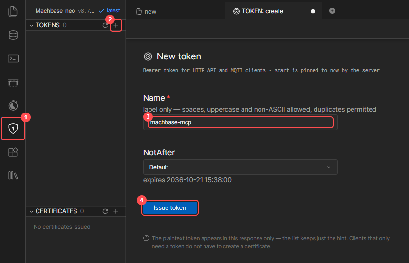
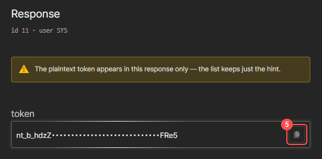
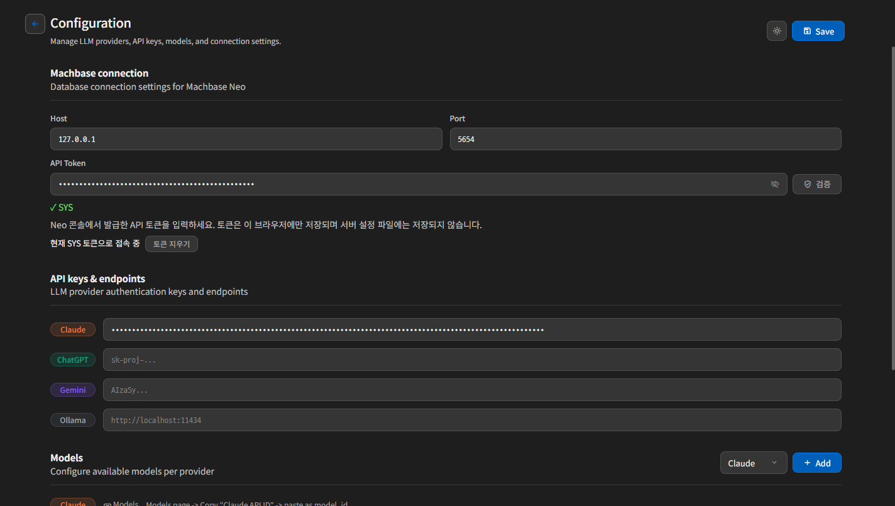

# 첫 설정

<strong>한국어</strong> | <a href="./first-setup.en.md">English</a> | <a href="./first-setup.ja.md">日本語</a>

처음 열었을 때 아직 설정이 없으면 Settings 화면이 먼저 표시됩니다.  
설정을 이미 저장한 사용자라면 바로 Chat 화면으로 들어갈 수 있습니다.

## 시작하기 전에: API 토큰 발급

LLM Chat은 Machbase Neo **API 토큰**으로 데이터베이스에 접속합니다.  
조회, 차트, 대시보드, 리포트는 모두 이 토큰 계정의 권한으로 실행됩니다.

1. Neo 웹 콘솔(`http://<neo-host>:5654`)에 LLM Chat을 사용할 계정으로 로그인합니다.
2. 방패 아이콘(**①**)을 누른 뒤, **TOKENS** 옆의 **+** 버튼(**②**)을 누릅니다.
3. 토큰 이름(**③**, 예: `llm-chat`)을 입력하고 **Issue token**(**④**)을 누릅니다. 만료일은 **NotAfter**에서 정할 수 있습니다.

   

4. 발급된 토큰(`nt_`로 시작)을 복사 버튼(**⑤**)으로 복사합니다.

   

> 토큰 문자열은 발급할 때 한 번만 표시됩니다. 잃어버렸다면 새로 발급합니다.  
> 토큰은 **콘솔에 로그인한 계정의 토큰**이어야 합니다. 다른 계정의 토큰은 검증 단계에서 거부됩니다.  
> 필요 버전: Machbase Neo 8.7.3 이상

## Machbase Connection

LLM이 질의 실행과 대시보드 생성에 사용할 Machbase Neo 연결 정보를 입력합니다.

| 항목 | 입력 값 |
| :--- | :--- |
| `Host` | Machbase Neo 주소 (예: `127.0.0.1`) |
| `Port` | Machbase Neo HTTP 포트 (기본 `5654`) |
| `API Token` | 위에서 발급한 토큰 |

### 토큰 검증

1. `API Token` 칸에 토큰을 붙여 넣습니다. 입력값은 가려지며, 오른쪽 눈 아이콘으로 확인할 수 있습니다.
2. **검증** 버튼을 누릅니다.
3. 칸 아래에 표시되는 결과를 확인합니다.

| 결과 표시 | 의미 | 조치 |
| :--- | :--- | :--- |
| `✓ JOY` | 유효한 토큰이며 콘솔 로그인 계정과 일치 | 다음 단계로 진행 |
| `✗ 유효하지 않은 토큰입니다` | 토큰이 틀렸거나 Neo에서 삭제·만료됨 | 토큰을 다시 복사하거나 새로 발급 |
| `✗ 콘솔 로그인 계정(JOY)과 다른 계정(SYS)의 토큰입니다` | 다른 계정의 토큰 | 콘솔에 로그인한 계정의 토큰을 입력 |
| `✗ Neo 콘솔 로그인 정보를 확인할 수 없습니다` | 콘솔에 로그인되어 있지 않음 | 콘솔에 로그인한 뒤 LLM Chat을 다시 열기 |

검증에 성공하면 `현재 JOY 토큰으로 접속 중`이 표시됩니다.  
이 계정으로 저장해 둔 설정이 서버에 있으면 그 설정을 자동으로 불러옵니다.

### 토큰 저장 방식

- 토큰은 **이 브라우저에만** 콘솔 계정별로 저장됩니다. 서버의 설정 파일에는 저장되지 않습니다.
- 한 번 저장하면 브라우저를 닫거나 PC·Neo를 재시작해도 다시 입력하지 않습니다.
- 다음 경우에는 토큰을 다시 입력합니다.
  - 다른 PC나 다른 브라우저에서 열 때
  - 브라우저의 사이트 데이터를 지웠거나 시크릿 창으로 열 때
  - 접속 주소가 바뀔 때 (`127.0.0.1`과 `192.168.x.x`는 서로 다른 저장소로 취급됩니다)
  - Neo에서 토큰을 삭제했거나 토큰이 만료됐을 때
- 같은 브라우저라도 콘솔 로그인 계정이 바뀌면 토큰 칸은 빈 상태로 시작합니다.
- 공용 PC에서는 사용을 마친 뒤 **토큰 지우기**를 누릅니다.

## API Keys & Endpoints

다음으로 사용할 LLM Provider 정보를 입력합니다.

지원되는 항목:

- `Claude`
- `ChatGPT`
- `Gemini`
- `Ollama`

입력 방식:

- Claude, ChatGPT, Gemini: API Key 입력
- Ollama: `base_url` 입력

모든 Provider를 다 채울 필요는 없습니다.  
실제로 사용할 Provider만 입력하면 됩니다.

프로바이더별 모델 목록 확인 위치:

- Claude
  - Anthropic Models 문서에서 `Claude API ID`를 확인합니다.
- ChatGPT
  - OpenAI Models 문서에서 `Model ID`를 확인합니다.
- Gemini
  - Gemini Models 문서에서 모델 코드를 확인합니다.
- Ollama
  - 로컬에 `ollama pull`로 내려받은 모델 이름을 그대로 사용합니다.

## Models 등록

LLM Chat은 Provider별로 사용할 Model을 별도로 등록합니다.

각 행에서 입력하는 값:

- `Provider`
- `Display Name`
- `Model ID`

예를 들어 화면에 보여줄 이름은 `GPT-4.1`, 실제 호출용 ID는 공급자 문서의 model id를 넣는 방식입니다.

설정 팁:

- Display Name은 사용자가 구분하기 쉬운 이름으로 넣습니다.
- Model ID는 Provider 문서에 나오는 정확한 값을 사용합니다.
- Ollama는 로컬에 `pull`한 모델 이름을 그대로 쓰면 됩니다.

## 저장 전 확인 사항

다음 조건이 만족되어야 저장할 수 있습니다.

- `Host`, `Port`, `API Token`이 비어 있지 않음
- API 토큰이 유효하고 콘솔 로그인 계정과 일치함 (Save를 누를 때 다시 검증합니다)
- 추가한 Model 행은 Display Name과 Model ID가 모두 채워짐
- 적어도 하나 이상의 Provider가 실제로 사용 가능함

실패하면 화면에 어떤 입력이 부족한지 또는 저장이 되지 않는 이유가 표시됩니다.

## Save 후 동작

설정을 저장하면 Chat 화면으로 이동합니다.  
Chat 화면 입력창 하단의 연결 상태 표시에 `Connected · JOY`처럼 접속 계정이 함께 표시됩니다.

이후에도 입력창 오른쪽 아래의 Settings(톱니바퀴) 버튼으로 다시 설정 화면을 열어 수정할 수 있습니다.

> 새 브라우저에서 토큰만 입력하고 Save를 누른 경우, 서버에 이 계정의 기존 설정이 있으면 먼저 그 설정을 불러오고 저장을 멈춥니다. 불러온 내용을 확인한 뒤 다시 Save를 누릅니다.

## 문서 이동

- [목차로 돌아가기](./index.kr.md)
- [다음: Chat 사용 방법](./chat-usage.kr.md)
